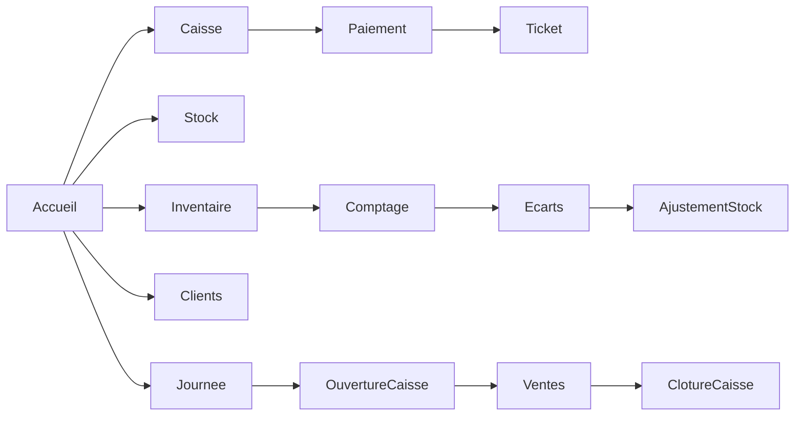
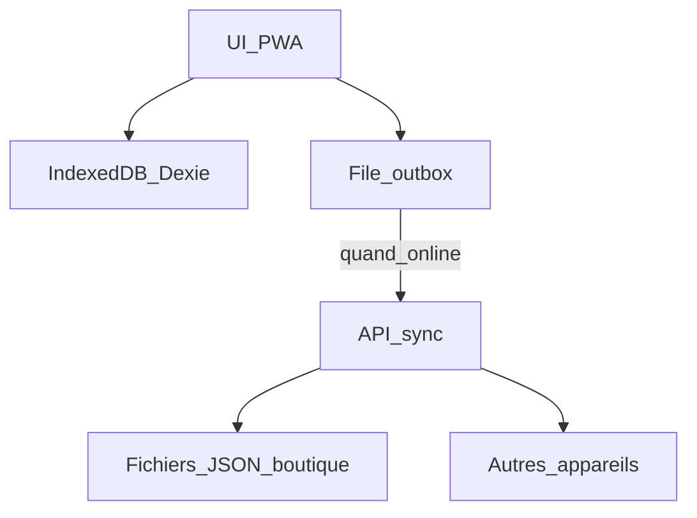

# CDC — vitePOS (PWA Gestion Boutique de Quartier)

**Version :** 1.1 (à jour avec l’implémentation)  
**Statut :** V1 livrée + évolutions terrain  
**Stack :** Vite + React + TypeScript + PWA (vite-plugin-pwa) + Dexie (IndexedDB) + sync Node locale  

---

## 1. Vision produit

Application web progressive (**PWA**) responsive, utilisable sur téléphone, tablette et petit PC, conçue pour les **boutiques de coin de quartier** (cible prioritaire : catalogues larges, cadence élevée) — notamment le contexte **Kinshasa (FC + USD)**.

**Promesse :** le commerçant gère caisse, stock, inventaire, clients et historique de ventes **même sans Internet**. Quand le réseau revient, les données se synchronisent entre appareils de la même boutique.

**Nom produit :** `vitePOS` — caisse rapide pour boutiques de quartier.

---

## 2. Contexte métier et personas

### Contexte
- Boutiques de proximité (épicerie, boutique générale, gros catalogue).
- Ticket moyen variable, **cadence élevée**, peu de temps pour saisir.
- Besoin central : **vendre vite**, **savoir ce qu’il reste**, **inventaire fiable**.
- Usage multi-personnes : propriétaire absent, gérant en caisse, famille qui aide.

### Personas

| Rôle | Besoin principal |
|------|------------------|
| **Propriétaire** | Suit le chiffre, le stock, les écarts d’inventaire ; peut ne pas être derrière la caisse |
| **Gérant** | Vend toute la journée, ouvre/ferme la caisse, ajuste le stock au quotidien |
| **Aide familiale / vendeur** | Enregistre des ventes rapidement, consulte le stock ; droits limités |

---

## 3. Principes produit (non négociables)

1. **Offline-first** — vendre, inventaire, stock, clients sans réseau.
2. **Vente rapide** — parcours caisse minimal (recherche / scan / liste / panier / encaissement).
3. **Inventaire facilité** — session guidée, écarts visibles, correction en 1 validation.
4. **1 boutique = 1 espace de données** — pas de multi-magasins en V1.
5. **Responsive mobile-first** — navigation pouce, grands tap targets.
6. **Rôles simples** — Propriétaire / Gérant / Vendeur.

---

## 4. Périmètre fonctionnel

### 4.1 Caisse (POS)
- Liste produits dense (style supermarché / PDF), pas de cards.
- Recherche nom / code article / catégorie / code-barres.
- Scan code-barres : douchette USB (tape le code puis Entrée) ou caméra sur tous les appareils (lecteur du navigateur s'il existe, sinon lecteur ZXing servi par l'app et gardé hors ligne).
- Filtres catégories + favoris.
- Panier : quantité saisie directe (− / champ / +), plafonnée au stock.
- Remise en **%** avec calcul automatique du montant (raccourcis 5 / 10 / 15 / 20 %).
- Paiements : **espèces**, **mobile money**, **mixte**.
- Espèces : **Francs FC (CDF)** ou **Dollars USD** selon le taux du jour.
- Rendu monnaie (billets rapides FC / USD).
- Ticket écran + impression navigateur (format 58/80 mm) + thermique ESC/POS.
- Annulation vente du jour (gérant / proprio).
- Client optionnel sur la vente.

### 4.2 Stock & catalogue
- Fiche produit en **modale** (focus ajout/édition) :
  - **code article** (LAI-001 : 3 lettres de la catégorie + numéro, proposé automatiquement, modifiable, unique dans la boutique), nom, catégorie, prix vente, prix achat (selon rôle),
  - stock initial / actuel, seuil d’alerte, unité, code-barres (scanné à la caméra ou tapé), favori caisse,
  - **emballages** (paquet, carton… 5 au plus) : nom, nombre d’unités, code-barres propre, prix propre. Le stock reste compté à l’unité.
- Mouvements manuels : réappro, casse, don, correction.
- Alertes stock bas.
- **Import CSV** massif + **export CSV**.
- Produits actifs / archivés (pas de suppression dure si déjà vendu).

### 4.3 Inventaire
- Session d’inventaire (en cours / validé / annulé).
- Comptage produit par produit, filtres catégorie / non comptés.
- Validation → écarts → ajustement stock + journalisation.

### 4.4 Clients
- Fiche : nom, téléphone, notes.
- Historique d’achats, compteur / total dépensé.
- Crédit client **hors V1** (V2).

### 4.5 Ventes & caisse journalière
- Historique des ventes.
- Session de caisse : ouverture (fond), clôture (totaux, écart).
- Synthèse du jour : CA, nb ventes, panier moyen, top produits.

### 4.6 Accueil
- CA du jour, alertes stock, inventaire en cours.
- Raccourcis (dont taux $, import CSV).
- Bannière / activation mode Kinshasa si besoin.

### 4.7 Comptes & rôles
- Créer boutique / rejoindre via code invitation.
- PIN par utilisateur.
- Droits :
  - **Propriétaire** : tout + utilisateurs + prix d’achat + inventaire + clôture
  - **Gérant** : caisse, stock, inventaire, clients, clôture
  - **Vendeur** : caisse + consultation

### 4.8 Offline & sync
- IndexedDB local (Dexie).
- Outbox + sync serveur léger (`/api/sync/:inviteCode`).
- Indicateur : En ligne / Hors ligne / Sync / Conflit.
- Conflits V1 : last-write-wins sur fiches ; ventes / mouvements append-only.

### 4.9 Devises (Kinshasa)
- Devise des prix : **CDF (Franc congolais)** par défaut.
- Paramètre **taux du jour** : `1 USD = X FC`.
- À l’encaissement : conversion auto total FC → USD ; rendu en $ possible.
- Migration des anciennes boutiques FCFA (XOF) → CDF + taux.

### 4.10 Impression tickets
- Impression navigateur (mise en page ticket 58/80 mm).
- Impression thermique native **ESC/POS** via **Web Serial** (Chrome/Edge).
- Options : largeur papier, auto-print après encaissement, test imprimante.

---

## 5. Hors périmètre V1 (reste V2+)

- Multi-boutiques / chaîne
- Comptabilité fiscale complète / TVA avancée / export expert-comptable
- Crédit client / carnet de dettes
- Fournisseurs & bons de commande
- Étiquettes internes à préfixe 2 (produits sans code), étiquettes de balance (prix ou poids dans le code)
- E-commerce / livraison
- Biométrie, SSO, gestion d’entreprise avancée

---

## 6. Parcours clés



**Vente :** Accueil → Caisse → ligne produit / scan → quantité / remise % → Encaisser → FC ou $ → ticket.

**Inventaire :** Inventaire → session → compter → écarts → valider (gérant/proprio).

**Import catalogue :** Stock → Import CSV → modèle / fichier → importer.

---

## 7. Modèle de données (conceptuel)

- `Boutique` — identité, devise (CDF), `usdRateCdf`, impression, invite
- `Utilisateur` — rôle, PIN/hash
- `Produit` — prix, stock, seuils, catégorie, barcode, favori
- `MouvementStock` — type, qté, motif, user, refId
- `SessionInventaire` + `LigneInventaire`
- `Client`
- `Vente` + lignes + paiements + devise paiement / taux / rendu
- `SessionCaisse`
- `OutboxSync`

---

## 8. Exigences non fonctionnelles

| Thème | Exigence |
|-------|----------|
| Offline | PWA installable ; données critiques en local |
| Perf caisse | UI non bloquante ; recherche différée sur gros catalogues |
| Responsive | Mobile 360px+, tablette, desktop |
| Langue | Français |
| Devise | CDF + USD (taux du jour) ; autres devises paramétrables |
| UX | Liste caisse dense ; fiche produit en modale ; gros boutons |
| UI | Palette type supermarché : bleu marine + rouge caisse |

---

## 9. Architecture technique

| Couche | Choix |
|--------|--------|
| Front | **Vite + React 19 + TypeScript** |
| Routing | React Router |
| Offline DB | **Dexie / IndexedDB** |
| PWA | vite-plugin-pwa (manifest + service worker) |
| Sync | API Express `server/index.mjs` (port 3789) + SQLite local + Neon |
| Impression thermique | Web Serial + ESC/POS |



### Lancer le projet

```bash
cd F:\dev_pro\vitepos
npm install
npm run dev
```

- App : http://localhost:5173/
- Sync : http://127.0.0.1:3789

---

## 10. Écrans

1. Onboarding (créer / rejoindre)
2. Login PIN
3. Accueil
4. Caisse (liste + panier)
5. Encaissement (FC / $ / MM / mixte)
6. Ticket
7. Stock (liste + modale fiche)
8. Import produits CSV
9. Alertes stock bas
10. Inventaire (+ session comptage)
11. Clients (+ détail)
12. Journée / caisse
13. Historique ventes
14. Plus / Paramètres (Kinshasa, taux $, impression, users, sync)

---

## 11. Critères d’acceptation (extraits)

- Vendre hors ligne (mode avion) ; stock décrémenté ; ticket visible.
- Saisir quantité 100 sans appuyer 99 fois sur +.
- Remise 10 % sur 10 000 FC → total 9 000 FC.
- Taux 1 $ = 2 800 FC ; panier 30 000 FC → ≈ 10,71 $ à l’encaissement USD.
- Import CSV de dizaines/centaines de produits.
- Vendeur ne valide pas inventaire / ne modifie pas les prix.
- Inventaire validé ajuste le stock avec écarts tracés.
- Sync : vente visible sur 2e appareil après sync (même code invitation).

---

## 12. Décisions produit

| Décision | Choix |
|----------|--------|
| Cible | SaaS en trois formules : Boutique, Pro (quincailleries, grossistes), Supermarché |
| Front | Vite (pas Next.js) |
| Offline | Cache hors ligne Firestore (Dexie et l'API Express abandonnés) |
| Comptes | Un compte Firebase par employé, plusieurs boutiques par projet, adhésion par code validée par le propriétaire |
| Essai gratuit | 30 jours, toutes les fonctions de la formule choisie |
| Non-paiement | 7 jours de grâce avec rappel, puis lecture seule (consultation et export, aucune suppression) |
| Prix des formules | Boutique 10 $, Pro 25 $, Supermarché 80 $ par magasin, par mois (à revoir après les pilotes) |
| Paiement | Mensuel par défaut ; annuel = 12 mois pour le prix de 10 (100 $, 250 $, 800 $) |
| Comptes par formule | Boutique 3, Pro 10, Supermarché illimité (propriétaire compris) |
| Formule pendant l'essai | Choisie à la création de la boutique, modifiable par le propriétaire tant que dure l'essai |
| Prolonger un abonnement | À la main au début : l'éditeur renseigne `paidUntil` (et `plan`, `billingCycle`) dans la console Firebase |
| Lecture seule | Bloquée aussi côté serveur (règles Firestore) : ventes, stock, dépenses, clients, inventaires, journée |
| Changement de formule | Réservé à l'éditeur de vitePOS (jamais au client), en attendant le paiement mobile money |
| Restaurant | Écarté pour l'instant |
| Version gratuite | Oui, en plus des formules payantes (limites à définir : comptes, produits, magasins) |
| Site de présentation | Astro dans `site/` (pages statiques, aucun JavaScript envoyé, rapide sur réseau faible), séparé de l'app ; textes dans `site/src/data/content.ts` ; inspiration Toposfy |
| Manuel de l'utilisateur | Prévu : un manuel attrayant façon magazine / journal (comme le rapport d'impact de BEPAS : couverture pleine page, gros titres condensés, sommaire numéroté, grands chiffres, encadrés « astuce »), illustré avec les vraies captures de l'app ; à lire sur le site et à télécharger en PDF A4 (partage WhatsApp, impression) |
| Prix sur le site | Non affichés : « Gratuit pour commencer », formules sur demande |
| Devises | Franc (CDF), dollar (USD) et euro (EUR) ; taux du jour du $ et de l'€ en FC, conversions via le franc ; l'euro n'apparaît que si son taux est saisi ; **le taux du jour est fixé par le propriétaire seul**, dans les Paramètres |
| Caisse UI | Liste dense type supermarché |
| Fiche produit | Modale |
| Code article | Identifiant interne de chaque produit : préfixe de catégorie + numéro (LAI-001, LAI-002…), proposé automatiquement et modifiable ; jamais réutilisé à l'import. Le code-barres GS1 (EAN-13…) reste celui du fabricant et est facultatif |
| Emballages | Un produit garde un seul stock, compté à l'unité (bouteilles). Ses emballages (Paquet de 24, Carton de 48…) ont leur code-barres et **leur propre prix, fixé par la boutique** (prix de gros, option A). En caisse : scanner la bouteille vend 1 bouteille, scanner le paquet vend le paquet et retire 24 du stock ; toucher l'article demande « à l'unité ou en paquet ». En réception : scanner le paquet ouvre l'entrée de stock comptée en paquets (3 paquets = +72). Pas encore dans l'import CSV |
| Scan caméra | Partout (caisse, stock, inventaire, fiche produit) et sur tous les appareils, hors ligne compris ; codes lus : EAN-13, EAN-8, UPC-A/E, ITF-14, Code 128, Code 39, QR, DataMatrix |
| Remise | Pourcentage |
| Impression | Navigateur + thermique ESC/POS |
| Look | Bleu marine + rouge caisse ; **mode clair et mode sombre** : « Automatique » (suit le téléphone, par défaut), « Clair » ou « Sombre », choisi dans Paramètres → Apparence ou par le menu du compte, gardé sur chaque appareil |
| Adresses | App : https://getvitepos.web.app ; site de présentation : https://vitepos-rdc.web.app (`vitepos.web.app` est pris par un autre projet) ; `vitepos-be79c.web.app` et `vitepos-app.web.app` redirigent vers l'app ; en attendant un nom de domaine |
| Accroche du site | « Vendez plus vite. Perdez moins. Même sans réseau. » + « Ventes, dépenses, bénéfice : tout est calculé pendant que vous vendez. Fini les comptes de tête à la fermeture. » ; trois promesses dessous (Fini le cahier / Plus un seul franc perdu / Votre boutique dans votre poche) ; mobile money et logos d'opérateurs retirés tant qu'il n'y a pas d'intégration réelle (FlexPay envisagé, d'abord pour payer les abonnements) |
| Crédit client / multi-boutiques | V2 |

---

## 13. Historique des versions CDC

| Version | Contenu |
|---------|---------|
| **1.0** | CDC initial : offline, caisse, stock, inventaire, clients, rôles, sync |
| **1.1** | + Vite confirmé, import CSV, liste caisse, remise %, quantité saisie, CDF/USD Kinshasa, ticket thermique, modale produit, UI supermarché |
| **1.2** | Migration Firebase, positionnement SaaS en trois formules, essai 30 jours, lecture seule après 7 jours de non-paiement |
| **1.3** | Euro, taux fixé par le propriétaire, codes article, scan caméra sur tous les appareils, emballages (paquet, carton) |

---

*Document généré pour le projet **vitePOS** (`vitepos`) — à faire évoluer avec le produit.*
