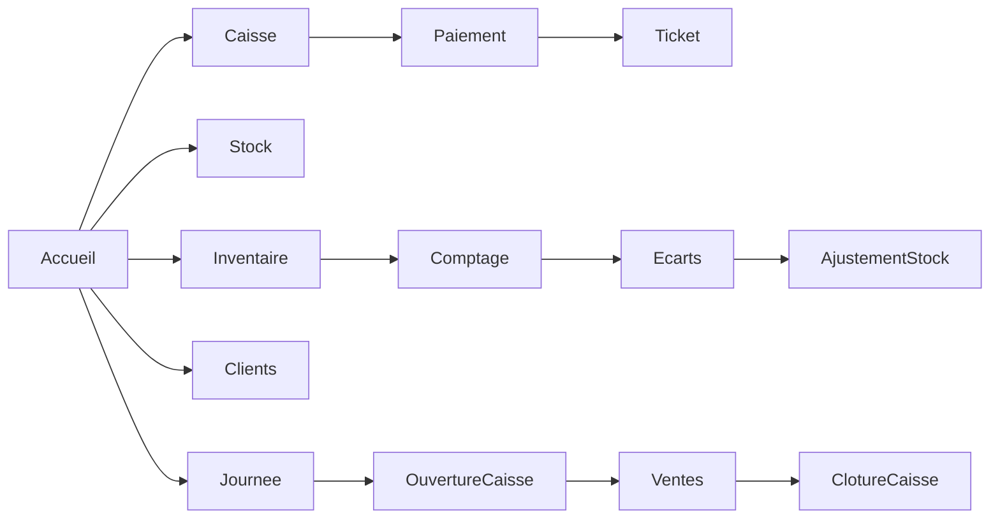
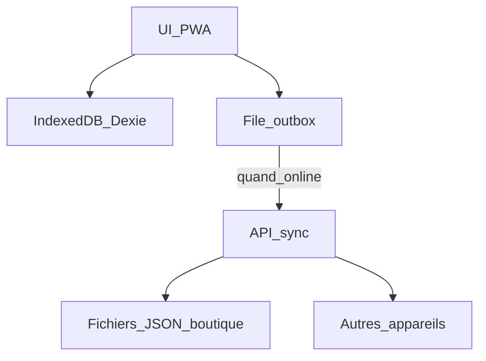

# CDC — vitePOS (PWA Gestion Boutique de Quartier)

**Version :** 1.1 (à jour avec l’implémentation)  
**Statut :** V1 livrée + évolutions terrain  
**Stack :** Vite + React + TypeScript + PWA (vite-plugin-pwa) + Dexie (IndexedDB) + sync Node locale  

---

## 1. Vision produit

Application web progressive (**PWA**) responsive, utilisable sur téléphone, tablette et petit PC, conçue pour les **boutiques de coin de quartier** (cible prioritaire : catalogues larges, cadence élevée) — notamment le contexte **Kinshasa (FC + USD)**.

**Promesse :** le commerçant gère caisse, stock, inventaire, clients et historique de ventes **même sans Internet**. Quand le réseau revient, les données se synchronisent entre appareils de la même boutique.

**Nom produit :** `vitePOS` — caisse rapide pour boutiques de quartier.

---

## 2. Contexte métier et personas

### Contexte
- Boutiques de proximité (épicerie, boutique générale, gros catalogue).
- Ticket moyen variable, **cadence élevée**, peu de temps pour saisir.
- Besoin central : **vendre vite**, **savoir ce qu’il reste**, **inventaire fiable**.
- Usage multi-personnes : propriétaire absent, gérant en caisse, famille qui aide.

### Personas

| Rôle | Besoin principal |
|------|------------------|
| **Propriétaire** | Suit le chiffre, le stock, les écarts d’inventaire ; peut ne pas être derrière la caisse |
| **Gérant** | Vend toute la journée, ouvre/ferme la caisse, ajuste le stock au quotidien |
| **Aide familiale / vendeur** | Enregistre des ventes rapidement, consulte le stock ; droits limités |

---

## 3. Principes produit (non négociables)

1. **Offline-first** — vendre, inventaire, stock, clients sans réseau.
2. **Vente rapide** — parcours caisse minimal (recherche / scan / liste / panier / encaissement).
3. **Inventaire facilité** — session guidée, écarts visibles, correction en 1 validation.
4. **1 boutique = 1 espace de données** — pas de multi-magasins en V1.
5. **Responsive mobile-first** — navigation pouce, grands tap targets.
6. **Rôles simples** — Propriétaire / Gérant / Vendeur.

---

## 4. Périmètre fonctionnel

### 4.1 Caisse (POS)
- Liste produits dense (style supermarché / PDF), pas de cards.
- Recherche nom / code article / catégorie / code-barres.
- Scan code-barres : douchette USB (tape le code puis Entrée) ou caméra sur tous les appareils (lecteur du navigateur s'il existe, sinon lecteur ZXing servi par l'app et gardé hors ligne).
- Filtres catégories + favoris.
- Panier : quantité saisie directe (− / champ / +), plafonnée au stock.
- Remise en **%** avec calcul automatique du montant (raccourcis 5 / 10 / 15 / 20 %).
- Paiements : **espèces**, **mobile money**, **mixte**.
- Espèces : **Francs FC (CDF)** ou **Dollars USD** selon le taux du jour.
- Rendu monnaie (billets rapides FC / USD).
- Ticket écran + impression navigateur (format 58/80 mm) + thermique ESC/POS.
- Annulation vente du jour (gérant / proprio).
- Client optionnel sur la vente.

### 4.2 Stock & catalogue
- Fiche produit en **modale** (focus ajout/édition) :
  - **code article** (LAI-001 : 3 lettres de la catégorie + numéro, proposé automatiquement, modifiable, unique dans la boutique), nom, catégorie, prix vente, prix achat (selon rôle),
  - stock initial / actuel, seuil d’alerte, unité, code-barres (scanné à la caméra ou tapé), favori caisse,
  - **emballages** (paquet, carton… 5 au plus) : nom, nombre d’unités, code-barres propre, prix propre. Le stock reste compté à l’unité.
- Mouvements manuels : réappro, casse, don, correction.
- Alertes stock bas.
- **Import CSV** massif + **export CSV**.
- Produits actifs / archivés (pas de suppression dure si déjà vendu).

### 4.3 Inventaire
- Session d’inventaire (en cours / validé / annulé).
- Comptage produit par produit, filtres catégorie / non comptés.
- Validation → écarts → ajustement stock + journalisation.

### 4.4 Clients
- Fiche : nom, téléphone, notes.
- Historique d’achats, compteur / total dépensé.
- Crédit client **hors V1** (V2).

### 4.5 Ventes & caisse journalière
- Historique des ventes.
- Session de caisse : ouverture (fond), clôture (totaux, écart).
- Synthèse du jour : CA, nb ventes, panier moyen, top produits.

### 4.6 Accueil
- CA du jour, alertes stock, inventaire en cours.
- Raccourcis (dont taux $, import CSV).
- Bannière / activation mode Kinshasa si besoin.

### 4.7 Comptes & rôles
- Créer boutique / rejoindre via code invitation.
- PIN par utilisateur.
- Droits :
  - **Propriétaire** : tout + utilisateurs + prix d’achat + inventaire + clôture
  - **Gérant** : caisse, stock, inventaire, clients, clôture
  - **Vendeur** : caisse + consultation

### 4.8 Offline & sync
- IndexedDB local (Dexie).
- Outbox + sync serveur léger (`/api/sync/:inviteCode`).
- Indicateur : En ligne / Hors ligne / Sync / Conflit.
- Conflits V1 : last-write-wins sur fiches ; ventes / mouvements append-only.

### 4.9 Devises (Kinshasa)
- Devise des prix : **CDF (Franc congolais)** par défaut.
- Paramètre **taux du jour** : `1 USD = X FC`.
- À l’encaissement : conversion auto total FC → USD ; rendu en $ possible.
- Migration des anciennes boutiques FCFA (XOF) → CDF + taux.

### 4.10 Impression tickets
- Impression navigateur (mise en page ticket 58/80 mm).
- Impression thermique native **ESC/POS** via **Web Serial** (Chrome/Edge).
- Options : largeur papier, auto-print après encaissement, test imprimante.

---

## 5. Hors périmètre V1 (reste V2+)

- Multi-boutiques / chaîne
- Comptabilité fiscale complète / TVA avancée / export expert-comptable
- Crédit client / carnet de dettes
- Fournisseurs & bons de commande
- Étiquettes internes à préfixe 2 (produits sans code), étiquettes de balance (prix ou poids dans le code)
- E-commerce / livraison
- Biométrie, SSO, gestion d’entreprise avancée

---

## 6. Parcours clés



**Vente :** Accueil → Caisse → ligne produit / scan → quantité / remise % → Encaisser → FC ou $ → ticket.

**Inventaire :** Inventaire → session → compter → écarts → valider (gérant/proprio).

**Import catalogue :** Stock → Import CSV → modèle / fichier → importer.

---

## 7. Modèle de données (conceptuel)

- `Boutique` — identité, devise (CDF), `usdRateCdf`, impression, invite
- `Utilisateur` — rôle, PIN/hash
- `Produit` — prix, stock, seuils, catégorie, barcode, favori
- `MouvementStock` — type, qté, motif, user, refId
- `SessionInventaire` + `LigneInventaire`
- `Client`
- `Vente` + lignes + paiements + devise paiement / taux / rendu
- `SessionCaisse`
- `OutboxSync`

---

## 8. Exigences non fonctionnelles

| Thème | Exigence |
|-------|----------|
| Offline | PWA installable ; données critiques en local |
| Perf caisse | UI non bloquante ; recherche différée sur gros catalogues |
| Responsive | Mobile 360px+, tablette, desktop |
| Langue | Français |
| Devise | CDF + USD (taux du jour) ; autres devises paramétrables |
| UX | Liste caisse dense ; fiche produit en modale ; gros boutons |
| UI | Palette type supermarché : bleu marine + rouge caisse |

---

## 9. Architecture technique

| Couche | Choix |
|--------|--------|
| Front | **Vite + React 19 + TypeScript** |
| Routing | React Router |
| Offline DB | **Dexie / IndexedDB** |
| PWA | vite-plugin-pwa (manifest + service worker) |
| Sync | API Express `server/index.mjs` (port 3789) + SQLite local + Neon |
| Impression thermique | Web Serial + ESC/POS |



### Lancer le projet

```bash
cd F:\dev_pro\vitepos
npm install
npm run dev
```

- App : http://localhost:5173/
- Sync : http://127.0.0.1:3789

---

## 10. Écrans

1. Onboarding (créer / rejoindre)
2. Login PIN
3. Accueil
4. Caisse (liste + panier)
5. Encaissement (FC / $ / MM / mixte)
6. Ticket
7. Stock (liste + modale fiche)
8. Import produits CSV
9. Alertes stock bas
10. Inventaire (+ session comptage)
11. Clients (+ détail)
12. Journée / caisse
13. Historique ventes
14. Plus / Paramètres (Kinshasa, taux $, impression, users, sync)

---

## 11. Critères d’acceptation (extraits)

- Vendre hors ligne (mode avion) ; stock décrémenté ; ticket visible.
- Saisir quantité 100 sans appuyer 99 fois sur +.
- Remise 10 % sur 10 000 FC → total 9 000 FC.
- Taux 1 $ = 2 800 FC ; panier 30 000 FC → ≈ 10,71 $ à l’encaissement USD.
- Import CSV de dizaines/centaines de produits.
- Vendeur ne valide pas inventaire / ne modifie pas les prix.
- Inventaire validé ajuste le stock avec écarts tracés.
- Sync : vente visible sur 2e appareil après sync (même code invitation).

---

## 12. Décisions produit

| Décision | Choix |
|----------|--------|
| Cible | SaaS en trois formules : Boutique, Pro (quincailleries, grossistes), Supermarché |
| Front | Vite (pas Next.js) |
| Offline | Cache hors ligne Firestore (Dexie et l'API Express abandonnés) |
| Comptes | Un compte Firebase par employé, plusieurs boutiques par projet, adhésion par code validée par le propriétaire |
| Essai gratuit | 30 jours, toutes les fonctions de la formule choisie |
| Non-paiement | 7 jours de grâce avec rappel, puis lecture seule (consultation et export, aucune suppression) |
| Prix des formules | Boutique 10 $, Pro 25 $, Supermarché 80 $ par magasin, par mois (à revoir après les pilotes) |
| Paiement | Mensuel par défaut ; annuel = 12 mois pour le prix de 10 (100 $, 250 $, 800 $) |
| Comptes par formule | Boutique 3, Pro 10, Supermarché illimité (propriétaire compris) |
| Formule pendant l'essai | Choisie à la création de la boutique, modifiable par le propriétaire tant que dure l'essai |
| Prolonger un abonnement | À la main au début : l'éditeur renseigne `paidUntil` (et `plan`, `billingCycle`) dans la console Firebase |
| Lecture seule | Bloquée aussi côté serveur (règles Firestore) : ventes, stock, dépenses, clients, inventaires, journée |
| Changement de formule | Réservé à l'éditeur de vitePOS (jamais au client), en attendant le paiement mobile money |
| Restaurant | Écarté pour l'instant |
| Version gratuite | Oui, en plus des formules payantes (limites à définir : comptes, produits, magasins) |
| Site de présentation | Astro dans `site/` (pages statiques, aucun JavaScript envoyé, rapide sur réseau faible), séparé de l'app ; textes dans `site/src/data/content.ts` ; inspiration Toposfy |
| Manuel de l'utilisateur | Fait : page `/manuel` du site de présentation, façon journal (une bleu nuit, sommaire numéroté, 13 chapitres du matin au soir, encadrés Astuce / Attention, grands chiffres), illustrée par les vraies captures de l'app de démonstration (`node preview/capture.mjs man-`) ; PDF A4 de 16 pages `manuel-vitepos.pdf` imprimé par Chrome depuis le site construit. Textes dans `site/src/data/manuel.ts`, à mettre à jour quand un écran change |
| Prix sur le site | Non affichés : « Gratuit pour commencer », formules sur demande |
| Devises | Franc (CDF), dollar (USD) et euro (EUR) ; taux du jour du $ et de l'€ en FC, conversions via le franc ; l'euro n'apparaît que si son taux est saisi ; **le taux du jour est fixé par le propriétaire seul**, dans les Paramètres |
| Caisse UI | Liste dense type supermarché |
| Secteurs affichés | Seulement ceux que vitePOS sert déjà bien : alimentation et supérettes, supermarchés, quincailleries et matériaux, pharmacies et parapharmacies, dépôts de boissons, grossistes et demi-gros, boulangeries et pâtisseries, cosmétiques, pièces de rechange auto et moto, téléphonie et accessoires. Villes citées : Kinshasa, Lubumbashi, Kolwezi, Matadi. Habillement retiré tant que les tailles ne sont pas gérées ; restaurants écartés |
| Feuille de route (demandée) | 1. IMEI / numéro de série et garantie (vendeurs de téléphones) ; 2. dates de péremption, pour tous les commerces (pharmacies, supermarchés…) ; puis crédit client, tailles et couleurs |
| Péremption | Option par produit « Suivre la péremption ». Une date à chaque arrivage (lot). Ce qui reste de chaque lot est estimé : les plus anciens partent en premier. Alerte « Bientôt périmés » 30 jours avant, sur l'accueil et dans Stock |
| IMEI et garantie | Option par produit (vendu à la pièce) « Numéro de série / IMEI » et durée de garantie en mois. Un IMEI par appareil, saisi ou scanné à l'arrivage ; IMEI obligatoire à la vente. Le ticket imprime l'IMEI et « Garantie jusqu'au … » ; un IMEI se recherche pour retrouver la vente |
| TVA | Pas de TVA dans vitePOS pour l'instant : prix TTC, le ticket reste un « reçu de vente », jamais une « facture ». En RDC, taux normal 16 %, assujettissement à partir de 80 M FC de chiffre d'affaires annuel, et facture normalisée obligatoire pour les assujettis (dispositif électronique fiscal ou système certifié DGI, depuis le 1er décembre 2025). On vise d'abord les commerces non assujettis ; les assujettis gardent leur appareil DGI pour la facture. Certification DGI à étudier plus tard (supermarchés) |
| Conditions et confidentialité | Pages sur le site (FR et EN), liées en pied de page et depuis l'inscription. Points proposés : essai 30 jours, 7 jours de grâce puis lecture seule, ticket = reçu de vente (pas de facture normalisée DGI), données à la boutique et exportables, hébergement Google Firebase en Belgique (europe-west1), pas de publicité ni de revente, conservation 12 mois après la fin de l'abonnement, réponse aux demandes sous 30 jours, responsabilité limitée à 12 mois d'abonnement, droit congolais et tribunaux de Kinshasa. À faire relire par un juriste ; coordonnées de l'éditeur à compléter |
| Langues du site | Site de présentation, manuel et brochure en français et en anglais (/en/), bouton FR / EN. L'app reste en français pour l'instant (le manuel anglais donne le sens de chaque bouton) |
| Vocabulaire | Ne plus écrire « du kiosque au supermarché » : dire « pour tous les secteurs d'activité » |
| Brochure | A5 recto-verso (148 × 210 mm) pour convaincre un commerçant (comptoir, WhatsApp) : recto accroche + captures + promesses + « Gratuit pour commencer » ; verso fonctions, « Pour tous les secteurs d'activité » (liste simple des secteurs, sans détail), trois étapes, « Site web : … ». Le QR code ouvre l'app. Bouton « Télécharger la brochure » en haut du site, sur la page /brochure et en pied de page. Prix non affichés ; numéro WhatsApp à ajouter quand il sera choisi |
| Ventes et dépenses sur six mois | En haut des Rapports : deux barres par mois (bleu = ventes, orange = dépenses, paire validée daltoniens et mode sombre), infobulle, vue tableau, montants convertis au taux du jour. Données : compteurs `boutiques/{id}/monthStats/{AAAA-MM}` mis à jour par `increment()` avec chaque vente, annulation et dépense (6 petites lectures au lieu de toutes les ventes, marche hors ligne). Ne comptent que les ventes et dépenses créées depuis (champ `inStats`) : pas de rattrapage de l'historique, l'app n'a pas encore de vrais clients |
| Navigation | Ordinateur : barre du haut Accueil, Caisse, Stock, Ventes, Dépenses, Rapports (si autorisé), Plus ; téléphone : barre du bas Accueil, Caisse, Stock, Ventes, Plus. « Plus » contient le reste (liste unique dans `src/components/sections.ts`) |
| Fiche produit | Modale |
| Code article | Identifiant interne de chaque produit : préfixe de catégorie + numéro (LAI-001, LAI-002…), proposé automatiquement et modifiable ; jamais réutilisé à l'import. Le code-barres GS1 (EAN-13…) reste celui du fabricant et est facultatif |
| Emballages | Un produit garde un seul stock, compté à l'unité (bouteilles). Ses emballages (Paquet de 24, Carton de 48…) ont leur code-barres et **leur propre prix, fixé par la boutique** (prix de gros, option A). En caisse : scanner la bouteille vend 1 bouteille, scanner le paquet vend le paquet et retire 24 du stock ; toucher l'article demande « à l'unité ou en paquet ». En réception : scanner le paquet ouvre l'entrée de stock comptée en paquets (3 paquets = +72). Pas encore dans l'import CSV |
| Scan caméra | Partout (caisse, stock, inventaire, fiche produit) et sur tous les appareils, hors ligne compris ; codes lus : EAN-13, EAN-8, UPC-A/E, ITF-14, Code 128, Code 39, QR, DataMatrix |
| Remise | Pourcentage |
| Impression | Navigateur + thermique ESC/POS |
| Look | Bleu marine + rouge caisse ; **mode clair et mode sombre** : « Automatique » (suit le téléphone, par défaut), « Clair » ou « Sombre », choisi dans Paramètres → Apparence ou par le menu du compte, gardé sur chaque appareil |
| Installation | PWA (pas de store) : carte « Installer vitePOS » sur l'accueil (masquable une semaine) et dans « Plus » tant que l'app n'est pas installée ; bouton « Installer » quand le navigateur le permet (Chrome, Edge), sinon explication : iPhone → Safari, Partager, « Sur l'écran d'accueil » ; autres → menu du navigateur |
| Adresses | App : https://getvitepos.web.app ; site de présentation : https://vitepos-rdc.web.app (`vitepos.web.app` est pris par un autre projet) ; `vitepos-be79c.web.app` et `vitepos-app.web.app` redirigent vers l'app ; en attendant un nom de domaine |
| Accroche du site | « Vendez plus vite. Perdez moins. Même sans réseau. » + « Ventes, dépenses, bénéfice : tout est calculé pendant que vous vendez. Fini les comptes de tête à la fermeture. » ; trois promesses dessous (Fini le cahier / Plus un seul franc perdu / Votre boutique dans votre poche) ; mobile money et logos d'opérateurs retirés tant qu'il n'y a pas d'intégration réelle (FlexPay envisagé, d'abord pour payer les abonnements) |
| Design du site | Site « pro », riche en images (pas minimaliste) : carrousel en haut de page (une diapositive par secteur : supermarché, pharmacie, téléphonie, quincaillerie, boutique ; pas d'étiquette de secteur au-dessus du titre ; une seule ligne de progression fixe sur toute la largeur du bas (dégradé bleu nuit vers rouge), sur laquelle seul le point rouge du logo avance d'une diapositive à l'autre, boutons pause / précédent / suivant à droite au-dessus ; le défilement ne s'arrête jamais tout seul, seul le bouton pause l'arrête), animation de fond tirée du logo (grand « V » en filigrane, son point rouge qui bat à chaque vente, son trait rouge qui traverse l'image à chaque diapositive) et notifications de ventes propres à chaque secteur posées sur le téléphone (3 à la fois, 2 sur téléphone ; carte bleu nuit vitrée, pastille d'icône colorée selon le type : vente vert, alerte orange, stock bleu, scan rouge ; le montant mis en avant) ; phrases d'accroche orientées gain de temps ou d'argent (« Des milliers d'articles, retrouvés en un instant », « Votre business dans la poche »…) ; on n'écrit plus « boutiques de quartier » ; **boutons : rectangles pleins sans bordure, identiques partout** ; **plus aucun coin arrondi sur le site** (cartes, icônes, bulles, photos, puces), sauf les formes rondes (points, flèches, pièces, numéros d'étapes) et les cadres d'appareils autour des captures (rouge = action principale, blanc sur fond sombre, bleu nuit sur fond clair), bande de ventes qui défile comme le rouleau d'une caisse, cartes photo par secteur, mosaïque, appel final sur photo, pied de page sombre en colonnes. Couleurs du logo (bleu nuit, rouge) |
| Fond du site | **Tout le site est sur le bleu nuit dégradé de l'accroche** (plus de fond blanc), **animé** : halos bleu et rouge qui dérivent lentement (20 à 28 s) et fines lignes à l'angle du trait du logo qui glissent, en CSS seul (léger pour les petits téléphones) ; par-dessus, **réseau de boutiques connectées** (points qui dérivent et se relient, quelques points rouges, réagit à la souris, s'arrête quand l'onglet est caché) et **objets du commerce qui flottent sur toute la largeur du fond**, derrière le contenu (l'argent en **pièces** FC, $ et €, pas en billets ; pile de pièces, étiquette code-barres, ticket, carton, téléphone avec l'app, étiquette de prix), 18 objets en flux continu et en quinconce, un sur trois plus loin et flou ; sur téléphone, un sur deux et plus petits ; le haut de page garde seulement le « V » en filigrane : la barre du haut est transparente sur l'accroche et prend le même bleu, flouté, en défilant, sans bordure ni ombre ; cartes en verre sombre **sans aucune bordure** (ni cartes, ni séparateurs, ni bande de ventes, ni pied de page) ; tailles de texte réduites. Le manuel et la brochure gardent leurs pages claires |
| Section « Pourquoi vitePOS » | **Bande dessinée en lignes « problème → solution »** : chaque ligne montre à gauche la vie sans vitePOS et à droite avec (flèche rouge entre les deux ; sur téléphone l'un sous l'autre avec une flèche vers le bas), pour comprendre d'un coup d'œil sans reconstituer l'histoire. Trois lignes : l'inventaire (un dimanche entier → fini avant l'ouverture), le stock (rayon vide et boîtes périmées → alerte à temps), le suivi (patronne loin et inquiète → elle voit tout depuis son téléphone). **Le déclic ouvre la section** : la première illustration est une vraie discussion (Patrick propose vitePOS, « c'est gratuit pour commencer » ; sa tante répond « Vraiment ? Comment ça marche ? Montre-moi ça ! »), avec la phrase « Moins de temps à compter, plus de temps pour vendre » et le bouton à droite. Juste après, « Une semaine plus tard… » : Grâce et sa patronne satisfaites (dessin `bd-8`). Puis les lignes problème → solution le prouvent. Personnages : Maman Ngalula, Grâce, Patrick. Gain de temps en fil rouge, phrase de fin « Moins de temps à compter, plus de temps pour vendre ». Problème un peu éteint, solution lumineuse avec un halo vert (pas de bordure). Dessins par IA en style « ligne claire » (`design/images-ia/BD-PROMPTS.md`, `public/bd/bd-N.webp`), bulles en texte FR et EN ; une case sans dessin affiche « Dessin à venir » : ne pas publier tant qu'il en reste. Les 7 dessins sont en place (originaux `design/images-ia/bd-1.jpg` à `bd-7.jpg` ; le mot « EMPTY » écrit par l'IA sur l'étiquette du rayon vide a été effacé) |
| Titre de la section Fonctions | « Tout votre business sur un seul écran » (en anglais « Your whole business on one screen ») : on ne dit plus « boutique », vitePOS sert tous les commerces ; même registre que « Votre business dans la poche » |
| Section « Pour qui » | Les 4 cartes photo par type de commerce (boutiques, quincailleries, pharmacies, supermarchés) sont retirées ; il reste le titre « Pour tous les secteurs d'activité », la liste des 10 secteurs et les villes, puis le bouton « Commencer gratuitement ». La mosaïque « Pensé pour les commerces de la RDC » est retirée (son bouton est gardé ici) |
| Section Appareils | Le cœur de la section : **les appareils où l'on utilise vitePOS** (quatre cartes : téléphone Android · iPhone, tablette Android · iPad, ordinateur Windows · Mac, terminal de caisse Android avec Chrome), puis les accessoires compatibles (douchette, imprimante 58/80 mm, caméra du téléphone). Au-dessus, une scène animée montre la synchronisation : une vente encaissée sur la tablette apparaît aussitôt sur l'ordinateur et le téléphone (boucle de 6 s). Remplace l'ancienne galerie de 7 captures et l'ancienne section « Matériel » |
| Navigation du site | Sur téléphone, bouton menu (toutes les sections, manuel, connexion, autre langue, en grandes lignes faciles à toucher) ; le lien de la section affichée est mis en avant dans le menu ; défilement doux (« molo molo ») vers la section choisie, 0,8 à 1,6 s selon la distance, qui démarre et finit en douceur ; chaque question de la FAQ a son icône (prix, matériel, réseau, installation, devises, sécurité) |
| Logo | On garde le « V » d'origine partout (un logo « Vi » plus détaillé a été essayé puis écarté) |
| Images du site | **Images créées par IA**, une par secteur (liste et textes à copier : `design/images-ia/PROMPTS.md`) ; jamais de photo d'une enseigne réelle (Kin Marché retiré). En attendant, photos libres de Wikimedia Commons, créditées dans le pied de page |
| Crédit client / multi-boutiques | V2 |

---

## 13. Historique des versions CDC

| Version | Contenu |
|---------|---------|
| **1.0** | CDC initial : offline, caisse, stock, inventaire, clients, rôles, sync |
| **1.1** | + Vite confirmé, import CSV, liste caisse, remise %, quantité saisie, CDF/USD Kinshasa, ticket thermique, modale produit, UI supermarché |
| **1.2** | Migration Firebase, positionnement SaaS en trois formules, essai 30 jours, lecture seule après 7 jours de non-paiement |
| **1.3** | Euro, taux fixé par le propriétaire, codes article, scan caméra sur tous les appareils, emballages (paquet, carton) |

---

*Document généré pour le projet **vitePOS** (`vitepos`) — à faire évoluer avec le produit.*
