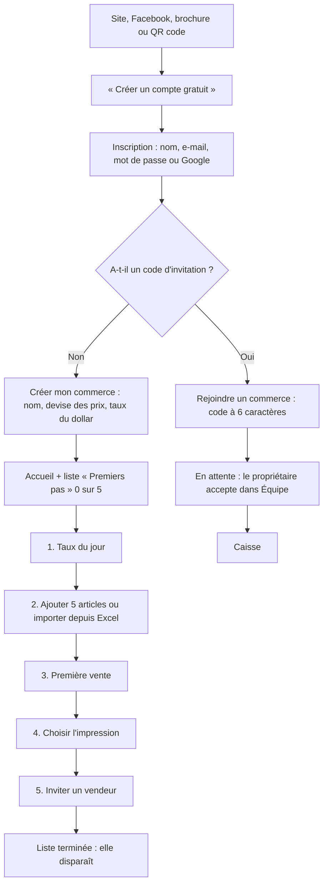
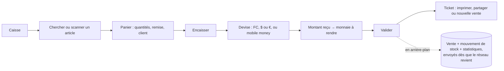
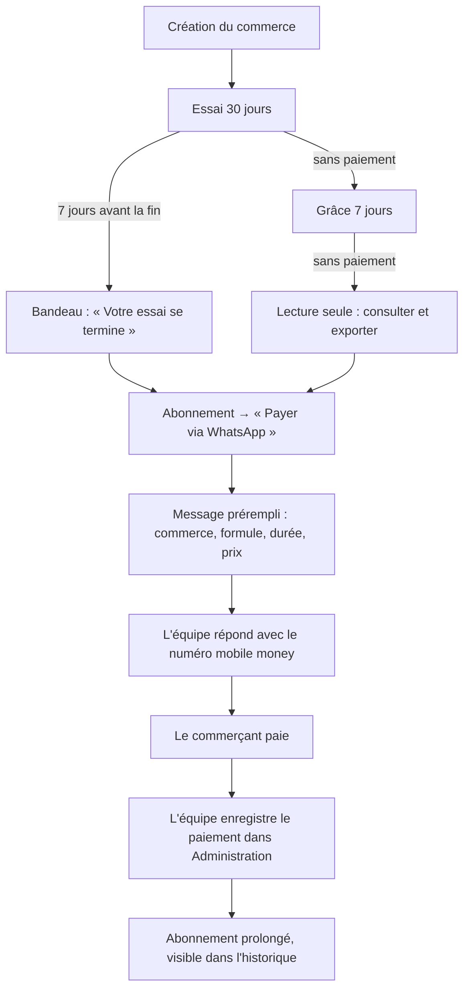

# APP FLOW : les parcours de vitePOS

Adresses : site `vitepos-rdc.web.app`, app `getvitepos.web.app` (plus tard `vitepos-rdc.com` et `app.vitepos-rdc.com`).

## 1. Du site à la première vente (nouveau commerçant)

À chaque étape : lien « Besoin d'aide ? WhatsApp » vers l'équipe vitePOS.

## 2. Une vente (hors ligne possible)

## 3. La journée de caisse

1. **Matin** : ouvrir la caisse, saisir le fond de caisse (FC, $, €).
2. **Journée** : ventes, dépenses payées depuis la caisse, annulations (avec motif).
3. **Soir** (gérant ou propriétaire) : compter l'argent, l'app calcule l'attendu et l'écart, clôturer.
4. Le propriétaire voit le résultat sur l'accueil, même à distance.

## 4. Le stock

- **Réception** de marchandise → stock +, mouvement « réappro ».
- **Casse, don, correction** → stock −, avec motif.
- **Inventaire** : compter article par article, valider → écarts appliqués en une fois.
- **Alerte** quand le stock passe sous le seuil (accueil et liste du stock).

## 5. L'abonnement

## 6. L'équipe

- Le propriétaire partage le **code d'invitation** du commerce (Équipe).
- L'employé crée son compte, saisit le code → demande « en attente ».
- Le propriétaire accepte, choisit le rôle (gérant ou vendeur) et peut ajuster les droits.
- Désactiver un compte bloque l'accès tout de suite ; ses ventes restent.

## 7. Écrans et rôles

| Écran | Propriétaire | Gérant | Vendeur |
| --- | --- | --- | --- |
| Accueil, Caisse, Ventes, Clients, Articles, Dépenses, Paramètres | oui | oui | oui (sans prix d'achat ni marges) |
| Modifier le stock, Inventaire | oui | oui | si droit « stock » |
| Modifier les prix | oui | oui | si droit « prix » |
| Journée de caisse | oui | oui | si droit « caisse » ou « rapports » |
| Rapports | oui | oui | si droit « rapports » |
| Équipe, Mon abonnement | oui | non | non |
| Administration | équipe vitePOS seulement | | |

Le gérant a tous les droits par défaut ; le propriétaire peut les retirer, ou en donner à un vendeur.
